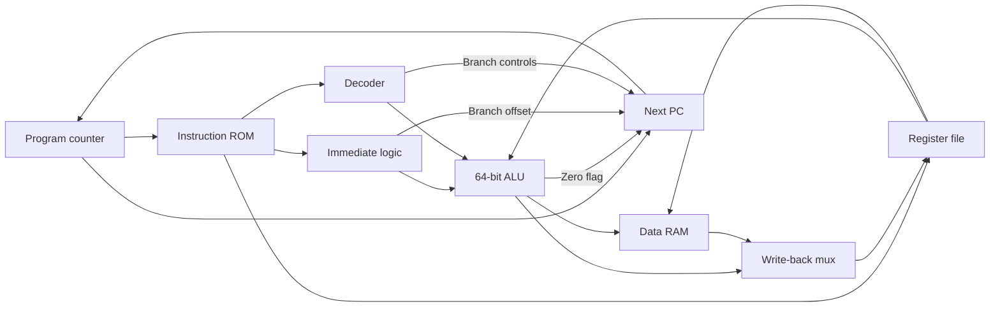

# ARMv8 CPU & RTL Verification Framework

A 64-bit, single-cycle CPU in Verilog that executes 11 instruction forms from an educational ARMv8-A (A64) subset. The core combines a 32 × 64-bit register file, ALU, immediate logic, instruction ROM, and byte-addressable data RAM. A Python reference model checks the hardware cycle by cycle under cocotb and Verilator.

[](https://github.com/Krrish-Verma/ARMv8-CPU/actions/workflows/rtl.yml)

## Run the regression

Use Ubuntu 24.04 or Ubuntu under WSL. The commands below install the same toolchain used by GitHub Actions.

```sh
git clone https://github.com/Krrish-Verma/ARMv8-CPU.git
cd ARMv8-CPU
sudo apt-get update
sudo apt-get install -y build-essential iverilog verilator python3-venv
python3 -m venv .venv
source .venv/bin/activate
python -m pip install -r requirements.txt
python -m verification.run
```

Run `python -m verification.run legacy` for the Icarus Verilog benches or `python -m verification.run cocotb --seed 0x350 --waves` for the Verilator tests with waveform tracing. The default seed is `0x350`. The runner saves the legacy demo trace to `build/icarus/singlecycle.vcd` and the optional Verilator CPU trace to `build/verilator/cpu/dump.vcd`. Each cocotb suite also writes a `results.xml` file in its build directory.

```sh
gtkwave build/icarus/singlecycle.vcd -S Lab07/SingleCycleProcTest.gtkw.tcl
```

## What the tests verify

| Suite | Checks |
| --- | --- |
| Icarus Verilog components | **1,004** checks across the ALU (532), immediate extender (408), and main decoder (64), plus 34 register-file, 202 multiplexer, and 7 next-PC checks |
| Icarus Verilog demo | Reaches the final load at PC `0x30` in 69 cycles, counts 15 loop iterations, and reloads `0xF` from data address `0x20` |
| Verilator decoder | Exhaustively checks all **2,048** values of `instruction[31:21]`, including 58 matches across the 11 forms and 1,990 default cases |
| Verilator processor | Runs a directed program plus **256 randomized instructions per seed**. The Python scoreboard checks the PC, write-back, stores, and final register and memory readbacks. Directed cases cover both branch directions, arithmetic wraparound, all four `MOVZ` shifts, reset, and invalid accesses. |

The [GitHub Actions workflow](.github/workflows/rtl.yml) runs both suites on pushes to `main` and on pull requests. Failed test assertions fail the job.

## Datapath



| Forms | Operand and result |
| --- | --- |
| `ADD`, `SUB` (register) | Two 64-bit registers with an unshifted second operand |
| `AND`, `ORR` (register) | Bitwise operations with an unshifted second operand |
| `ADD`, `SUB` (immediate) | 12-bit unsigned immediate with optional `LSL #12` |
| `MOVZ` | 16-bit immediate placed at bit 0, 16, 32, or 48, with other bits cleared |
| `LDUR`, `STUR` | 64-bit load or store at base plus a signed 9-bit byte offset |
| `CBZ`, `B` | Conditional zero branch with a signed 19-bit offset, or unconditional branch with a signed 26-bit offset. Both offsets are in words and relative to the current PC. |

The educational profile treats register encoding 31 as `XZR` in every operand position, including memory bases and immediate arithmetic. The core uses a 1,024-word instruction ROM and 1 KiB of big-endian data RAM. Eight-byte data accesses may be unaligned if the entire access fits. Out-of-bounds loads return zero and stores are discarded. An unsupported instruction or invalid fetch advances the PC by four with writes disabled. Synchronous reset loads `startpc` and suppresses writes while asserted. Programs initialize any general-purpose register they read.

## Load a custom program

`SingleCycleProc` runs the built-in demo by default. To run your own image, instantiate it with `PROGRAM_FILE` set to a Verilog `$readmemh` file. Put one 32-bit hexadecimal instruction word per line, starting at byte address zero. Resolve relative paths from the simulation working directory. Custom images start with zero-filled data RAM.

```verilog
SingleCycleProc #(.PROGRAM_FILE("example.hex")) dut (
    .CLK(clk), .reset(reset), .startpc(64'd0),
    .currentpc(pc), .MemtoRegOut(writeback)
);
```

`example.hex` stores 43 at data address zero, reloads it into `X3`, and stays at PC `0x10`. The last two lines set the final ROM word to zero using a word address.

```text
d2800541
91000422
f80003e2
f84003e3
14000000
@3ff
00000000
```

## Source map

| Path | Contents |
| --- | --- |
| [`Lab07/SingleCycleProc.v`](Lab07/SingleCycleProc.v) | CPU top level and datapath integration |
| [`Lab07/`](Lab07/) | Opcode decoder, instruction ROM, data RAM, and demo bench |
| [`Lab05/`](Lab05/) and [`Lab06/`](Lab06/) | Register file, ALU, immediate extension, next-PC logic, and component benches |
| [`verification/`](verification/) | Simulation runner, test-program generator, Python reference model, and cocotb tests |

The repository includes supporting coursework from Texas A&M's ECEN 350 Computer Organization labs. The assembly, cache, and compiler exercises are separate from the processor regression. [Upstream ECEN 350 labs](https://github.com/pgratz1/ECEN350_Labs) · [Apache License 2.0](LICENSE)
