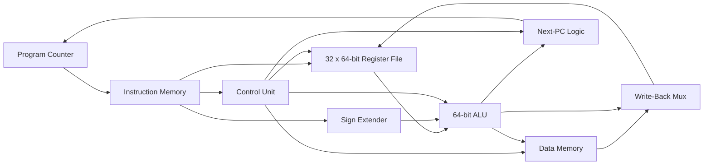

# ARMv8 Single-Cycle CPU

A computer architecture portfolio project that builds from ARMv8 assembly fundamentals to a working single-cycle processor in Verilog. The completed hardware integrates a 64-bit ALU, register file, immediate generator, control unit, instruction memory, data memory, and next-PC logic into one datapath.

> **Current status:** Labs 1-7 are complete. Labs 8-9 are retained as course material and work in progress; they are not presented as finished work.

## Highlights

- Implemented a single-cycle CPU for a focused subset of the ARMv8 instruction set.
- Designed and integrated reusable Verilog modules for the datapath and control path.
- Enforced ARMv8 register semantics, including a hard-wired zero register (`X31`/`XZR`).
- Built self-checking testbenches with directed and randomized test cases.
- Used VCD waveforms and GTKWave scripts to inspect timing and datapath behavior.
- Practiced ARMv8 assembly, calling conventions, stack discipline, branching, and memory access from C.

## Processor Architecture



The processor currently supports:

| Category | Instructions |
|---|---|
| Memory | `LDUR`, `STUR` |
| Arithmetic | `ADD`, `SUB` (register and immediate forms) |
| Logic | `AND`, `ORR` |
| Control flow | `CBZ`, `B` |
| Immediate | `MOVZ` |

## Verification Results

The repository includes the testbenches, compiled Icarus Verilog simulations, VCD waveforms, and captured console output used during development.

| Component | Coverage recorded in repository | Result |
|---|---:|---|
| 64-bit ALU | 532 directed/random checks | Pass, 0 errors |
| Sign extender | 408 checks across I, D, CB, and B formats | Pass, 0 errors |
| Single-cycle control | 64 opcode/control checks | Pass, 0 errors |
| Integrated processor | Program result, loop count, and final PC | Pass, 3/3 checks |

The integrated test program executes 69 cycles and verifies a final result of `0xF`, 15 loop iterations, and a final PC of `0x30`. See [`Lab07/SingleCycleProcTest_output.txt`](Lab07/SingleCycleProcTest_output.txt) for the captured run.

## Repository Structure

| Directory | Topic | Status |
|---|---|---|
| `Lab01` | C performance benchmarking and compiler optimization | Complete |
| `Lab02` | ARMv8 calling convention, shifts, addressing, and loads | Complete |
| `Lab03` | Conditional/unconditional branches and loops | Complete |
| `Lab04` | Functions, callee-saved registers, and stack alignment | Complete |
| `Lab05` | Gates, multiplexer, and 32 x 64-bit register file | Complete |
| `Lab06` | ALU, sign extension, and next-PC logic | Complete |
| `Lab07` | Control unit and integrated single-cycle processor | Complete |
| `Lab08` | Cache performance analysis from an address trace | In progress |
| `Lab09` | Comparing C with compiler-generated assembly | In progress |

## Key Hardware Modules

| Module | Location | Responsibility |
|---|---|---|
| `RegisterFile` | `Lab05/RegisterFile.v` | Two asynchronous read ports, one clocked write port, and `XZR` behavior |
| `mux2to1_8` | `Lab05/mux2to1_8.v` | 8-bit two-input multiplexer |
| `ALU` | `Lab06/ALU.v` | 64-bit AND, OR, ADD, SUB, and pass-through operations with zero detection |
| `SignExtender` | `Lab06/SignExtender.v` | Immediate extraction and sign extension for I, D, CB, and B formats |
| `NextPClogic` | `Lab06/NextPClogic.v` | Sequential PC updates and conditional/unconditional branch selection |
| `SC_Control` | `Lab07/SingleCycleControl.v` | Opcode decoding and datapath control-signal generation |
| `SingleCycleProc` | `Lab07/SingleCycleProc.v` | Top-level processor datapath integration |

## Running the Verilog Simulations

### Prerequisites

- [Icarus Verilog](https://steveicarus.github.io/iverilog/) (`iverilog` and `vvp`)
- [GTKWave](https://gtkwave.sourceforge.net/) (optional, for VCD waveform inspection)

### ALU

```sh
cd Lab06
iverilog -g2012 -o ALUTest.out ALUTest.v ALU.v
vvp ALUTest.out | tee ALUTest_output.txt
```

### Sign Extender

```sh
cd Lab06
iverilog -g2012 -o SignExtenderTest.out SignExtenderTest.v SignExtender.v
vvp SignExtenderTest.out | tee SignExtenderTest_output.txt
```

### Control Unit

```sh
cd Lab07
iverilog -g2012 -o SingleCycleControlTest.out \
  SingleCycleControlTest.v SingleCycleControl.v
vvp SingleCycleControlTest.out | tee SingleCycleControlTest_output.txt
```

### Integrated Processor

Run this command from the repository root so the cross-lab module paths resolve correctly:

```sh
iverilog -g2012 -o Lab07/SingleCycleProcTest.out \
  Lab07/SingleCycleProcTest.v \
  Lab07/SingleCycleProc.v \
  Lab07/SingleCycleControl.v \
  Lab07/InstructionMemory.v \
  Lab07/DataMemory.v \
  Lab05/RegisterFile.v \
  Lab05/mux2to1_8.v \
  Lab06/ALU.v \
  Lab06/SignExtender.v \
  Lab06/NextPClogic.v

vvp Lab07/SingleCycleProcTest.out | tee Lab07/SingleCycleProcTest_output.txt
```

To inspect a generated waveform:

```sh
gtkwave Lab07/singlecycle.vcd -S Lab07/SingleCycleProcTest.gtkw.tcl
```

## Running the C and ARMv8 Assembly Labs

Labs 1-4 are intended for an ARMv8/AArch64 Linux environment with GCC and GNU Make. Each lab or lab part has its own `Makefile`:

```sh
cd Lab03
make
./Lab03
make clean
```

The assembly exercises cover argument passing and return values, shifts, typed memory loads, branches and loops, and stack-based preservation of callee-saved registers.

## Skills Demonstrated

- Verilog RTL design and hierarchical module integration
- CPU datapath and control-path design
- ARMv8 instruction encoding and assembly programming
- Digital logic verification with self-checking testbenches
- Randomized and directed testing
- Waveform-based debugging with VCD/GTKWave
- C/assembly interoperability and GNU build tools

## Notes and Attribution

This repository contains educational work completed for ECEN 350 (Computer Organization). It includes course-provided starter/support files from the [original ECEN 350 lab repository](https://github.com/pgratz1/ECEN350_Labs) alongside the completed implementations and tests.

Labs 8 and 9 remain unfinished by design and are included only to preserve the full course workspace.

## License

The included course repository is distributed under the [Apache License 2.0](LICENSE).
